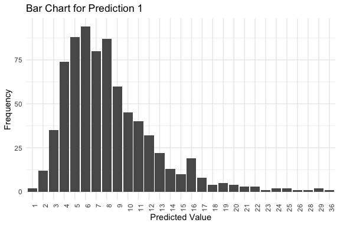
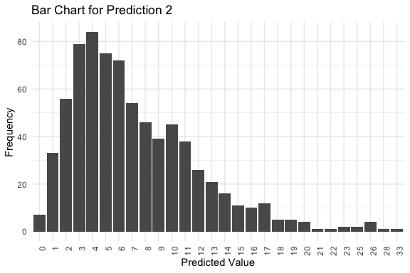
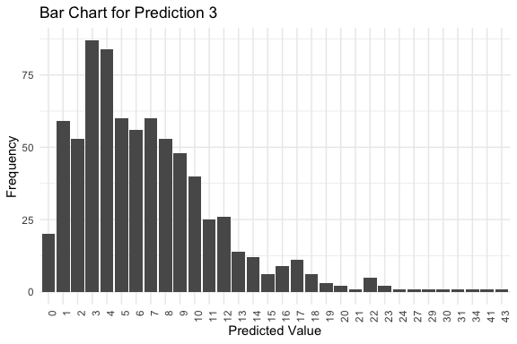
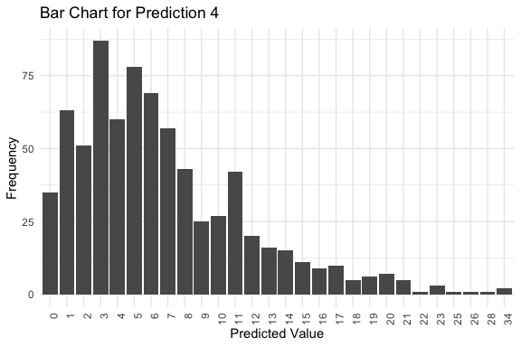
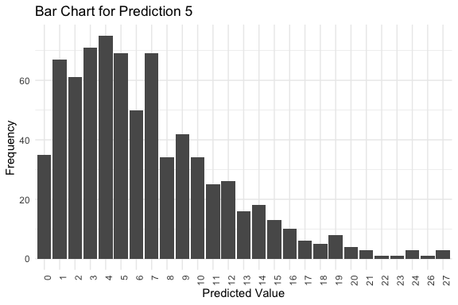

<!--  README.md is generated from README.Rmd. Please edit that file -->

The First-order Integer-valued Autoregressive (INAR(1)) model with
zero-inflated (ZI-INAR(1)) and hurdle (H-INAR(1)) innovations is widely
used in studying integer-valued time-series data, such as crime count
and heatwave frequency. This work implemented the INAR(1) models in
Stan. The package now also supports zero-inflated INAR(1) models with
Conway-Maxwell-Poisson (CMP) innovations.

## Installation

You can install ZIHINAR1 from GitHub with:

``` r
remotes::install_github("fushengyy/ZIHINAR1")
```

Or you can install the released version of ZIHINAR1 from
[CRAN](https://CRAN.R-project.org) with:

``` r
install.packages("ZIHINAR1")
```

## Basic Features get_stanfit()

The package contains main function named get_stanfit().

``` r
stan_fit <- get_stanfit(mod_type, distri, y, n_pred = 4,
                        thin = 2, chains = 1, iter = 2000, warmup = iter/2,
                        seed = NA, M = NULL,
                        cmp_version = c("fast", "reference"),
                        cmp_tail_tol = 1e-6, tail_action = c("warn", "error"), ...)
```

- `mod_type`: Character string indicating the model type. Use `"zi"` for
  zero-inflated models and `"h"` for hurdle models.

- `distri`: Innovation distribution. Options:

  - `"poi"`: Poisson
  - `"nb"`: Negative Binomial
  - `"gp"`: Generalized Poisson (ZI only)
  - `"cmp"`: Conway-Maxwell-Poisson (ZI only)

- `y`: A numeric vector of integers representing the observed data.

- `n_pred`: Integer specifying the number of time points for future
  predictions (default is 4).

- `thin`: Integer indicating the thinning interval for Stan sampling
  (default is 2).

- `chains`: Integer specifying the number of Markov chains to run
  (default is 1).

- `iter`: Integer specifying the total number of iterations per chain
  (default is 2000).

- `warmup`: Integer specifying the number of warmup iterations per chain
  (default is `iter`/2).

- `seed`: Numeric seed for reproducibility (default is NA).

- `M`: CMP innovation cutoff. The default is the larger of 300 and
  `max(y)`.

- `cmp_version`: CMP Stan implementation, either `"fast"` (default) or
  `"reference"`. Both use the same likelihood and priors.

- `cmp_tail_tol`: Tolerance for the CMP omitted probability mass bound
  (default is `1e-6`).

- `tail_action`: Use `"warn"` (default) or `"error"` when the CMP tail
  bound exceeds the tolerance. Increase `M` and refit if this happens.

- `...`: Additional arguments passed to `rstan::stan()`.

## Example

The following are examples showing how to fit the INAR(1) model when
data is generated from a zero-inflated Negative Binomial (ZINB)
distribution.

``` r
library(ZIHINAR1)
y_data <- data_simu(n = 100, alpha = 0.5, rho = 0.3, lambda = 5, disp = 2, 
                    mod_type = "zi", distri = "nb")
stan_fit <- get_stanfit(mod_type = "zi", distri = "nb", y = y_data, n_pred = 5, 
                        iter = 2000, chains = 1, warmup = 500, 
                        thin = 2, seed = 42)
#> 
#> SAMPLING FOR MODEL 'anon_model' NOW (CHAIN 1).
#> Chain 1: 
#> Chain 1: Gradient evaluation took 0.000174 seconds
#> Chain 1: 1000 transitions using 10 leapfrog steps per transition would take 1.74 seconds.
#> Chain 1: Adjust your expectations accordingly!
#> Chain 1: 
#> Chain 1: 
#> Chain 1: Iteration:    1 / 2000 [  0%]  (Warmup)
#> Chain 1: Iteration:  200 / 2000 [ 10%]  (Warmup)
#> Chain 1: Iteration:  400 / 2000 [ 20%]  (Warmup)
#> Chain 1: Iteration:  501 / 2000 [ 25%]  (Sampling)
#> Chain 1: Iteration:  700 / 2000 [ 35%]  (Sampling)
#> Chain 1: Iteration:  900 / 2000 [ 45%]  (Sampling)
#> Chain 1: Iteration: 1100 / 2000 [ 55%]  (Sampling)
#> Chain 1: Iteration: 1300 / 2000 [ 65%]  (Sampling)
#> Chain 1: Iteration: 1500 / 2000 [ 75%]  (Sampling)
#> Chain 1: Iteration: 1700 / 2000 [ 85%]  (Sampling)
#> Chain 1: Iteration: 1900 / 2000 [ 95%]  (Sampling)
#> Chain 1: Iteration: 2000 / 2000 [100%]  (Sampling)
#> Chain 1: 
#> Chain 1:  Elapsed Time: 0.656 seconds (Warm-up)
#> Chain 1:                1.818 seconds (Sampling)
#> Chain 1:                2.474 seconds (Total)
#> Chain 1:
get_est(distri = "nb", stan_fit = stan_fit)
#>             Mean         SD    Median       Q2.5     Q97.5      Rhat 95%_HPD_Lower 95%_HPD_Upper
#> alpha  0.4698743 0.05105897 0.4761154 0.36081446 0.5589632 0.9999792   0.361243245     0.5591202
#> rho    0.2258471 0.12798091 0.2228731 0.02060225 0.4858715 1.0024684   0.005271078     0.4496370
#> lambda 4.4128266 0.74546675 4.3652389 3.12326655 6.0788370 1.0063409   2.824085820     5.7147138
#> phi    1.5557630 0.74007545 1.3769369 0.64861912 3.4650565 1.0020000   0.500559232     2.9273579
get_mod_sel(y = y_data, mod_type = "zi", distri = "nb", stan_fit = stan_fit)
#>      EAIC     EBIC      DIC    WAIC1    WAIC2
#> 1 531.541 541.9215 526.9322 526.6891 526.9263
get_pred(stan_fit = stan_fit)
#> $summary
#>          Mode Median IQR Min Max
#> y_pred.1    6      7   5   1  36
#> y_pred.2    4      6   6   0  33
#> y_pred.3    3      6   6   0  43
#> y_pred.4    3      6   6   0  34
#> y_pred.5    4      5   6   0  27
#> 
#> $plots
#> $plots[[1]]
```



    #> 
    #> $plots[[2]]



    #> 
    #> $plots[[3]]



    #> 
    #> $plots[[4]]



    #> 
    #> $plots[[5]]



## Example with CMP innovations

For CMP, `disp` in `data_simu()` is the dispersion parameter `nu`
reported by `get_est()`. The parameter `lambda` is the CMP rate.

``` r
set.seed(42)
y_cmp <- data_simu(n = 100, alpha = 0.5, rho = 0.3, lambda = 2.5, disp = 1.2,
                   mod_type = "zi", distri = "cmp")
fit_cmp <- get_stanfit(mod_type = "zi", distri = "cmp", y = y_cmp, n_pred = 5,
                       iter = 2000, chains = 4, warmup = 1000, seed = 42)
get_est(distri = "cmp", stan_fit = fit_cmp)
get_mod_sel(y = y_cmp, mod_type = "zi", distri = "cmp", stan_fit = fit_cmp)
get_pred(stan_fit = fit_cmp)
```
